

# AR Object Labels

**First update on the Unity AR/XR intake project · Talha Abid · November 2026**

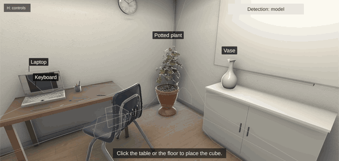

All three milestones run in the Unity Editor with XR Simulation, including the stretch goal: a small
pretrained detector inside Unity's Inference Engine.

| Milestone | Status | Where to see it |
|---|---|---|
| A. AR rig and XR Simulation | Done | `Assets/Scenes/Main.unity` and [How it works](#how-it-works) |
| B. A cube on a found surface, moved, with a world-space label | Done | [Run it](#run-it) |
| C. From a 2D box to a label in the room | Done: a hard-coded box, true boxes, then YOLOv9-T in the Inference Engine | [How it works](#how-it-works) and [Choosing the detector](#choosing-the-detector) |

<a href="https://youtu.be/KTcQVAig_nw">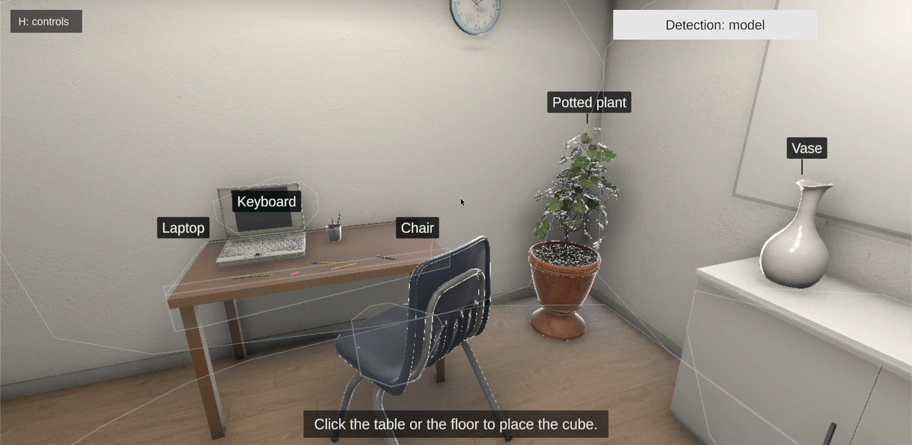</a>

▶ <a href="https://youtu.be/KTcQVAig_nw">Watch the 2:25 walkthrough on YouTube</a>: Unity Hub to the tests.

---

## Run it

1. Install Unity **6000.3.28f1**, choose **Add project from disk** in Unity Hub and pick this folder.
2. Open `Assets/Scenes/Main.unity` and press **Play**. XR Simulation and my test room are already chosen.
3. Look around for a few seconds so the simulator finds surfaces, then click the floor or a table.

| Action | How |
|---|---|
| Move · look | W A S D to move, Q and E for down and up, Shift for faster. Hold the right mouse button to look |
| Place · move · remove the cube | click a found surface, drag it, or click to carry it and click to put it down, R key to remove the cube |
| Change where labels come from | the **Detection** button: model, off, fixed box, true box |
| Show or hide the controls | H key to show or hide the controls |

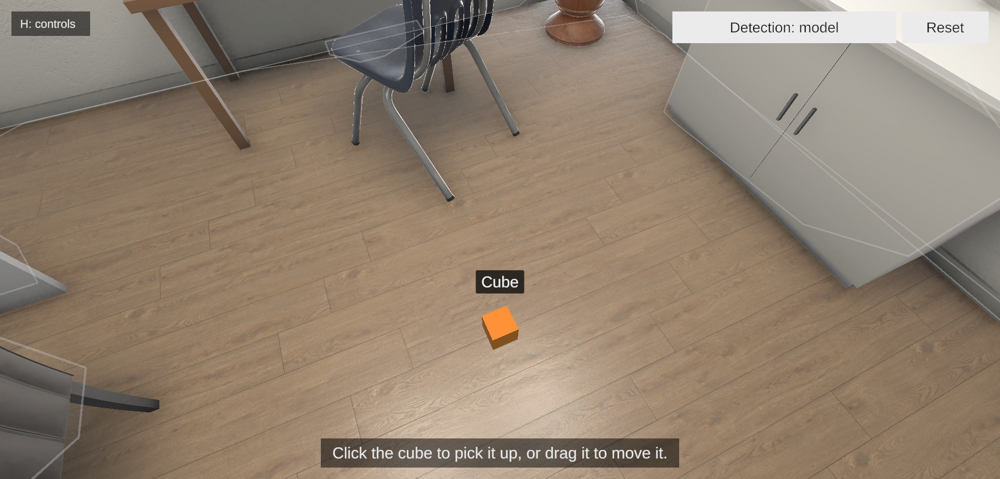 
The cube on a found surface, with its own label.

Package versions, tests and the one expected Console line

| Package | Version |
|---|---|
| AR Foundation (`com.unity.xr.arfoundation`) | 6.3.5 |
| XR Plug-in Management | 4.6.1 |
| Inference Engine (`com.unity.ai.inference`) | 2.6.1 |
| Input System | 1.20.1 |
| Unity UI with TextMesh Pro (`com.unity.ugui`) | 2.0.0 |
| Universal Render Pipeline | 17.3.0 |
| Test Framework | 1.6.0 |

The versions are pinned in `Packages/manifest.json`, apart from XR Plug-in Management, which comes with
AR Foundation and is pinned in `Packages/packages-lock.json`. Tests: Window › General › Test Runner › Edit Mode ›
Run All. A ten-minute check by hand is in [MANUAL-TEST.md](MANUAL-TEST.md). This Console line at Play
start is expected: `InputActionReference(Unlock) not provided. Navigation Actions will be active by default.`

---

## How it works

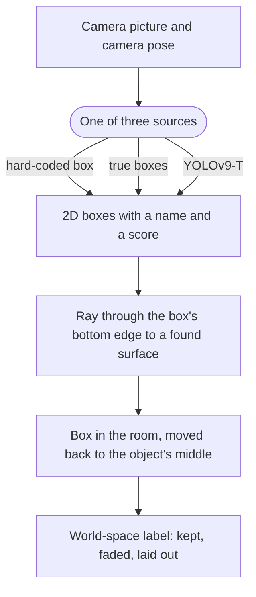

1. **2D boxes** with the camera's pose come from one of three sources: a box I hard-coded, true boxes from
   where the room's objects really are, or YOLOv9-T on AR Foundation's camera picture.
2. **Into the room.** A ray from that pose through the middle of the box's bottom edge meets the surface the
   object stands on. The point moves back by half the box's width, to the object's middle.
3. **The label** sits above that box in the room, faces the camera and keeps one text size on screen. It
   waits when its object is missed for a moment, then fades. At most six show, laid out off each other.

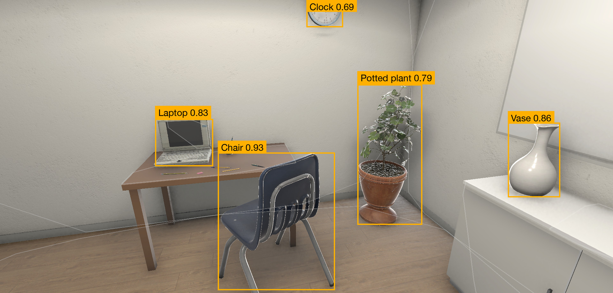 
The model's 2D boxes on the camera picture, with their scores.
  
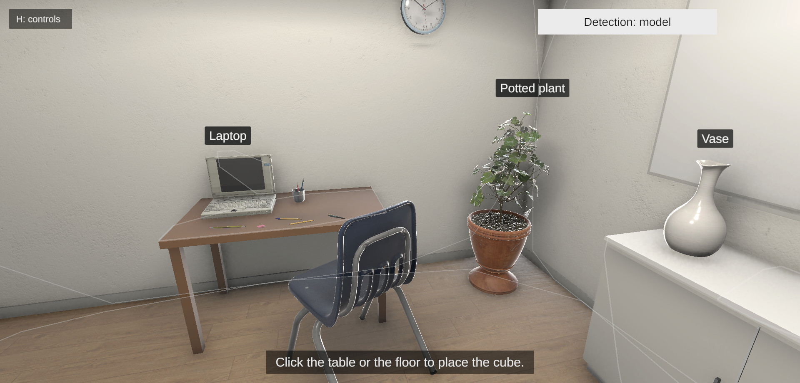 
The same view in the app. The chair's and the clock's boxes touch the picture's edge, so they start no label.

<table>
<tr>
<td width="50%">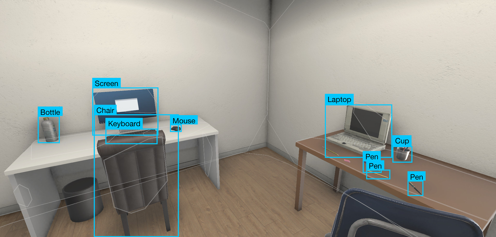</td>
<td width="50%">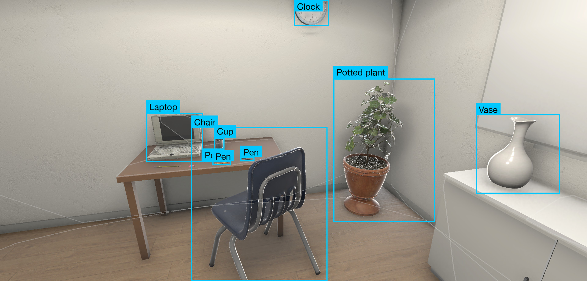</td>
</tr>
<tr>
<td align="center">True boxes, made from where each marked object really is.</td>
<td align="center">True boxes in the plant corner. The plant's box is much wider than the model's.</td>
</tr>
<tr>
<td>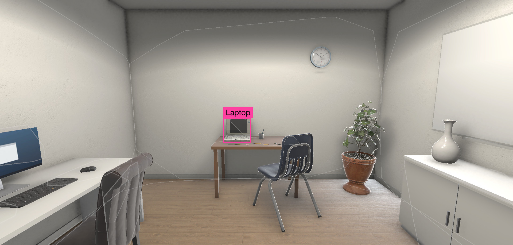</td>
<td>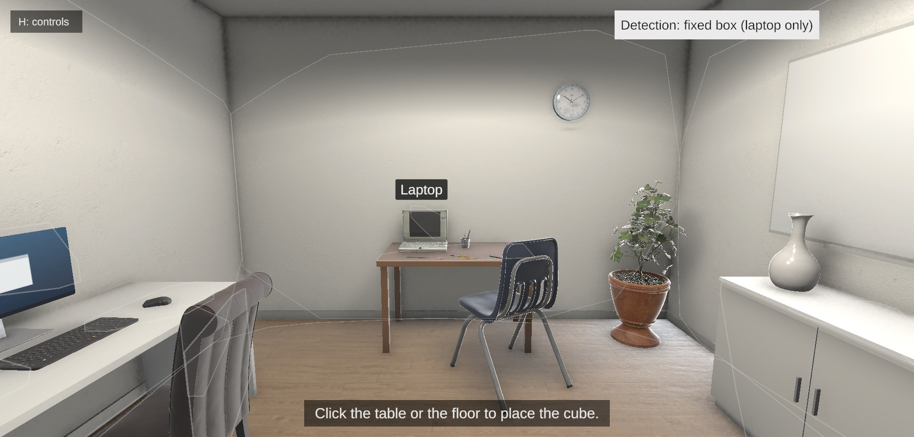</td>
</tr>
<tr>
<td align="center">The one hard-coded box, for the laptop in the starting view.</td>
<td align="center">Its label in the app.</td>
</tr>
</table>

<picture>
<source media="(prefers-color-scheme: dark)" srcset="docs/images/chart-placement-dark.svg">
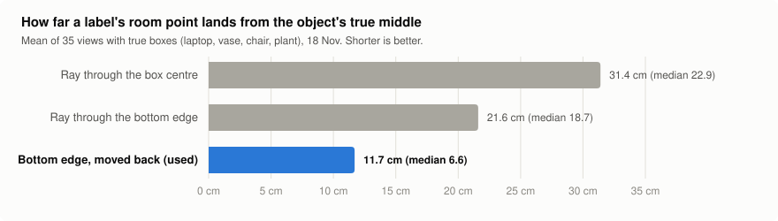
</picture> 
Why the bottom edge: measured with true boxes, so the detector plays no part.

The rig is AR Foundation's own: **XR Origin** (plane and raycast managers) › Camera Offset › **Main Camera**
(AR Camera Manager, AR Camera Background, Tracked Pose Driver), plus **AR Session**. Every rule and setting:
[docs/HOW-IT-WORKS.md](docs/HOW-IT-WORKS.md).

---

## My decisions and why

| What I chose | Why |
|---|---|
| Plain 3D template, AR Foundation added by hand | So I set every AR setting myself and can explain each one. |
| My own room | Sample rooms may not go in a public repo, and detectors found almost nothing in their untextured pictures. |
| Three sources, one path | True boxes measure the 2D-to-3D step without detector mistakes. |
| Ray through the box's bottom edge, moved back | Over 35 views: 31.4 cm off for the box centre, 11.7 cm this way. |
| Camera pose kept with each picture | A model result arrives frames later, after the camera moved. |
| Light text on a dark plate, one size on screen | Text on a solid plate was read fastest in Gabbard et al. (2006). When text grew with distance, it ranged from 18 to 77 px. |
| The name alone, "Laptop" | "I am a ..." breaks for scissors or skis, and less text reads easier. |
| At most six labels, biggest first | Nearest-first gave all six to pens and chairs, none to the laptop. |
| Labels hold still while the camera moves | Otherwise they swapped places every 0.2 s. |
| A label after 3 runs at 0.40 | With one run, a test walk showed 3 wrong labels. With three runs it showed 1. |
| Click to carry the cube, as well as drag | Dragging blocked looking around: both need a mouse button. |

**Not done, by choice.** I did not train a model yet. I would like to fine-tune one later, because no model I found
detects every everyday object. I left out the XR Interaction Toolkit because I wanted to write and explain the cube
code myself. I did not use AR anchors, because tracking never drops in the simulator, so I could not see what they
change.

---

## What I learned

This was my first Unity project.
- The simulator finds surfaces only while the camera moves. When I moved the camera too fast, it never found
  the desk top.
- Play stands still when Unity is not the front app, which stopped my test runs more than once.
- A tiny rounding error froze the Editor in a loop. Since then, tests of looping rules have a time limit.
- The camera picture came in mirrored, so every model box was on the wrong side until a saved test picture
  showed it.
- Measuring changed my mind. The viewing angle mattered less than I expected, and a chair rule that passed its
  tests did nothing in Play.
- A single Play run can give different numbers from the next. In one run the table top was found 6 mm higher,
  and the cup's error went from 1.3 to 6.5 cm with no change to the code.
- The model's speed depends on the frame rate: 10 runs a second here would be about 4 at 60 frames a second.
- A result read back from the graphics card can be read only in the frame it arrives. Missing that gave an
  error when I switched back to the model.

Where I am stuck: in model mode the school chair's label lands at the table's edge.

---

## What worked, what did not, and what I dropped

| Worked | Did not, or not yet |
|---|---|
| Rig, XR Simulation and my own room | No pen in model mode: COCO has no pen class |
| The cube: place, drag, carry, remove, with its own label | Short wrong names still flash up while the camera moves |
| Labels stay at their objects while I walk, one text size | The model calls screens "Keyboard" |
| One 2D-to-3D path for all three sources. With true boxes, after two later fixes, 7.1 cm from the object's middle on average (median 3.7, 18 Nov) | No label until a surface is found, and labels crowd at the pen cup |
| The model runs about 10 times a second inside Unity without stalling the picture | |

**Tried and dropped:** YOLOX-Tiny (my first model), two larger detectors, the box-centre ray, text that grows
with distance, a label width limit, "I am a ...", nearest-first labels, a chair floor rule, and my first fix
for the switching error, which broke the model until I repaired it.

---

## Problems I hit

These are the problems that cost me the most time: 9 fixed, 4 partly fixed, 5 still open. The open
ones are the chair label in model mode, the pen with the model, crowded pen labels, the pencils and the eraser,
and the cube landing on the chair's seat.

All 18, with what I did

| # | What happened | What I did | Now |
|---|---|---|---|
| 1 | At the start no surfaces showed, so nothing could be placed and no label could appear | Found that the simulator scans only while the camera moves. A hint now says to look around | Partly |
| 2 | I could not look around while dragging the cube, and the keys moved the camera only with the right button held | Added click to pick up and carry, and my own key settings | Fixed |
| 3 | The room looked wrong: the lights burned the walls white and the metal cup came out black | Turned the lights down and fixed the cup's reflection settings | Fixed |
| 4 | A ray through the box centre put the laptop's label on the back wall, 30.8 cm off | Cast the ray through the box's bottom edge and moved the point back by half the box width: 11.7 cm off on average over 35 views | Fixed |
| 5 | A box has no depth, so the keyboard's label sat on the monitor behind it | Gave seven classes a usual depth | Partly |
| 6 | In model mode the school chair's label lands at the table's edge | Tried a rule to stand chairs on the floor. It did nothing in Play, so I reverted it | Open |
| 7 | The camera picture came in mirrored, so every model box was on the wrong side | Turned off the flip setting I had taken from Unity's sample | Fixed |
| 8 | The model cannot see a pen, the brief's own example: COCO has no pen class, and it missed the cup | Tried a bigger detector that found pens. It froze the picture at every run and its training data is for academic use only. Pens show in true box mode | Open |
| 9 | The model gave wrong names: "Keyboard" on screens, and short flashes of "Remote", "Refrigerator" and "Couch" | A label now needs 3 runs in a row at a score of 0.40, and a box cut by the picture's edge starts no label | Partly |
| 10 | The model's own names read badly, such as "tv" for the monitor | Wrote my own display names: "Screen", "Potted plant" | Fixed |
| 11 | My first detector comparison was unfair: one score cut-off for every model, and different picture sizes | Redid it with every score kept and the same number of wrong labels for each model | Fixed |
| 12 | Running the model hurt the app: a long frame at every run, an error after switching back or losing focus, and 30 MB of garbage a second | Spread each run over frames, read a result only while Unity still holds it, and reused one array | Fixed |
| 13 | When labels moved to the best place every frame, they jumped and swapped places | First smoothed their moves (a short hold, a glide, a bonus for labels already shown), which cut jumps from 40 to 13. Then the layout held still while the camera moves and settles once it stops | Partly |
| 14 | All six labels went to pens and chairs and none to the laptop | Labels go to the biggest objects in the picture first | Fixed |
| 15 | Several pens get one label each and crowd over the cup | Not solved: merging them into one "Pens (3)" label is not built | Open |
| 16 | The pencils and the eraser never get a label | The model has no class for them, and in true box mode I marked only the three pens and the cup | Open |
| 17 | Old labels stayed in the air forever, labels hid under the panels, and text size changed with distance | Labels now fade and go after 10 s unseen, panels count as edges, and text keeps one size on screen | Fixed |
| 18 | A click on the table behind the school chair puts the cube on the chair's seat | None yet | Open |

---

## Choosing the detector

I ran every model on the same 315 pictures of my room (45 views, also made dark, bright, blurred, far,
half-covered and grainy, with 1,404 objects). I compared how many objects each found with no more than 25 wrong
labels, so no model gains from a lucky score cut-off. Then I looked at speed in Unity, file size and licence.

| Model, picture size | Found | GPU ms | File | Verdict |
|---|---:|---:|---:|---|
| **YOLOv9-T 640** | **505** | **26.8** | **8 MB** | **Picked:** more finds than the two nearest in speed, under half their file, MIT |
| YOLOX-S 640 | 577 | 32.3 | 36 MB | Most finds, but 4.5 times the file, twice the CPU time |
| YOLOX-Tiny 640 | 483 | 24.1 | 20 MB | Slightly fewer finds, 2.5 times the file |
| PicoDet-L 416 | 480 | ~26 | 23 MB | Slightly fewer finds, nearly 3 times the file |
| YOLOv9-T / YOLOX-Tiny 416 | 366 / 358 | 18.4 / 14.6 | 8 / 20 MB | Faster, but the small picture lost a quarter of the finds |
| YOLOX-Nano 416 | 329 | ~6 | 4 MB | Fastest, but fewest finds |

Also not picked: **D-FINE-S** found pens and the cup but froze the picture 130 ms a run and gave 20 wrong labels
in 18 pictures. **DEIM-D-FINE-N** was slow and found nothing new. **Ultralytics** models are AGPL, which would
cover my whole repo. Details: [docs/MODEL-CHOICE.md](docs/MODEL-CHOICE.md).

---

## Questions for you

1. Labels appear with a short delay, and when I let them adapt all the time they kept jumping. How should
   label adaptation work: when should a label move, and when should it stay put?
2. No detector I found covers every everyday object. How would you tackle that?
3. When several objects of one kind sit close together, like the three pens on my table, should each get its
   own label, or should they share one label such as "Pens (3)"?

---

## My setup

A MacBook Pro with an M1 Pro chip, no headset, no separate graphics card. All tools I used are free. On my first
day Unity could not reach its online package registry from my connection, so I installed AR Foundation and the
inference package from the copies that ship with the Editor. It reaches the registry now (checked 21 Nov).

---

## Limits

**The model**
- It knows COCO's 80 classes only, so there is no pen, pencil or eraser. It missed the metal cup except from 0.5 m.
- It calls the laptop's and the monitor's screens "Keyboard", and it gives short wrong names while the camera
  moves ("Remote", "Refrigerator", "Couch", "Mouse" on the pencil cup).
- It doesn't find the desk chair from straight behind. A box cut by the picture's edge often gets the wrong class
  ("Bicycle" for a cut-off clock), so cut boxes start no label.
- It was trained on photos and runs on a rendered room. In my first test, detectors found textured objects about
  as often as in photos, but untextured ones much less.

**Labels over time**
- A label appears after 3 runs, about 0.4 s. A wrong name can still slip through for a moment.
- A label whose object is in view but lost waits 1 s, then fades. Out of view it stays up to 10 s.
- Smoothing label moves cut jumps from 40 to 13 on my walks, but they're not gone. Since the layout also holds
  while the camera moves, held labels can lag or be cut by the edge until the camera stops for 0.5 s.
- At most six labels show. They can still overlap or crowd at the pen cup, and when no near place is free a label
  sits away from its object with its line hidden.

**Placing and the simulator**
- Only XR Simulation in the Editor on macOS: real camera pictures, phone speed and tracking loss are untested.
- Depth is not measured: a usual depth for seven classes, otherwise the box width.
- No AR anchors, so a session reset on a phone would leave labels in the wrong place.
- In true box mode the pencils and the eraser have no box, because only the three pens and the cup are marked.

**What I could not do yet**
- Label a pen with the model. The only detector I found that saw pens (D-FINE-S) froze the picture at every run,
  and its training data is for academic use only.
- Fix the chair label in model mode: it lands at the table's edge.
- Group several objects of one kind into one label: three pens lying close together get three separate "Pen"
  labels, not one "Pens (3)" (question 3).

Every limit and every measured number: [docs/TEST-RESULTS.md](docs/TEST-RESULTS.md).

---

## Credits

An AI assistant helped with the code and helped run the automated tests, checks and benchmarks.

**Learning:** the [Unity Essentials pathway](https://learn.unity.com/pathway/unity-essentials) on Unity Learn (certification course in progress),
and these tutorials:

13 tutorial videos

- [Tap to Place Objects in Unity's AR Foundation](https://www.youtube.com/watch?v=lYDfV-GaKQA), samyam
- [Setup a Unity 6 AR foundation project in 3 minutes](https://www.youtube.com/watch?v=hbBqu_LgAis), Alive Studios
- [How to Configure XR Simulation in Unity for Augmented Reality (2024)](https://www.youtube.com/watch?v=NCIPFP_dTyc), Joed
- [Unity 6: Place Objects in AR with Plane Detection](https://www.youtube.com/watch?v=e6WB3GVcF3E), Alive Studios
- [Unity Input System in Unity 6 (1/7): Input Action Editor](https://www.youtube.com/watch?v=TiTKAseu17A), Unity
- [Place UI Elements in your World!](https://www.youtube.com/watch?v=Zwgj3mwOVlg), Code Monkey
- [Billboarding in Unity](https://www.youtube.com/watch?v=eiGvVgwtJ8k), Firnox
- [How to convert the mouse position to world space in Unity](https://www.youtube.com/watch?v=5NTmxDSKj-Q), Game Dev Beginner
- [Screen/World Point in Unity](https://www.youtube.com/watch?v=CRbd2A8u4Uo), { j }code
- [Lerp smoothing is broken](https://www.youtube.com/watch?v=LSNQuFEDOyQ), Freya Holmér
- [Unity 6 automated tests – Edit Mode and Play mode](https://www.youtube.com/watch?v=5G1pPvEf15k), Raz Men
- [Unity Profiler Walkthrough & Tutorial](https://www.youtube.com/watch?v=xjsqv8nj0cw), Unity
- [Unity Sentis and Meta Quest Camera Access](https://www.youtube.com/watch?v=V14cYfLa8Rc), Valem Tutorials

Reused models and assets, with links and licences

| What | From | Licence |
|---|---|---|
| YOLOv9-T model | [LibreYOLO](https://huggingface.co/LibreYOLO/LibreYOLO9t), weights from [MultimediaTechLab/YOLO](https://github.com/MultimediaTechLab/YOLO) | MIT |
| Plant, vase, chairs, laptop, stationery, clock and bottle, plus floor and wall textures and room reflections | [Poly Haven](https://polyhaven.com) | CC0 |
| Monitor, keyboard and mouse | [GregorJan](https://sketchfab.com/3d-models/monitor-dell-p2314h-c69f09bb812e46cdbd5bf6c62499b848), [gorzi](https://sketchfab.com/3d-models/mouse-and-keyboard-c63ee81b71ff45b68a778101b4df3d46) on Sketchfab | CC BY 4.0 |
| Project template and TextMesh Pro files, and the Liberation Sans font | Unity | Unity Companion License, and SIL OFL 1.1 for the font |
| The idea that a kept label inside a new box of its class is the same object | [Meta's object detection sample](https://github.com/oculus-samples/Unity-PassthroughCameraApiSamples) | idea only |

**Key reading.** Your [design space paper](https://arxiv.org/abs/2411.02607) helped me decide where a label's
position, direction and size should come from. Your [glanceable AR paper](https://doi.org/10.1109/VR51125.2022.00063)
uses the same chain I built, from the camera to a detector to a box. In your [iAR paper](https://arxiv.org/abs/2411.02684),
my detector output is what you call a sensed input. Also Bell et al. on [view management](https://sites.cs.ucsb.edu/~holl/pubs/bell-2001-uist.pdf),
Gabbard et al. on [text legibility](https://hdl.handle.net/10919/25504), and Madsen et al. on
[temporal coherence](https://doi.org/10.1109/TVCG.2016.2518318) (abstract only). Everything else, and what I
reused against what I made: [docs/SOURCES.md](docs/SOURCES.md).

## Licence

My code is MIT ([LICENSE](LICENSE)). Third-party files keep their own licences, with full texts in
[THIRD-PARTY-NOTICES.md](THIRD-PARTY-NOTICES.md).
