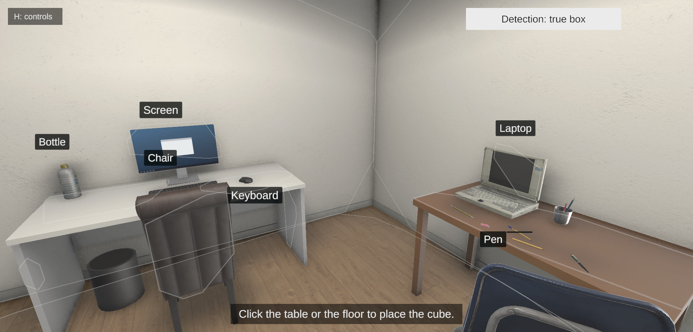
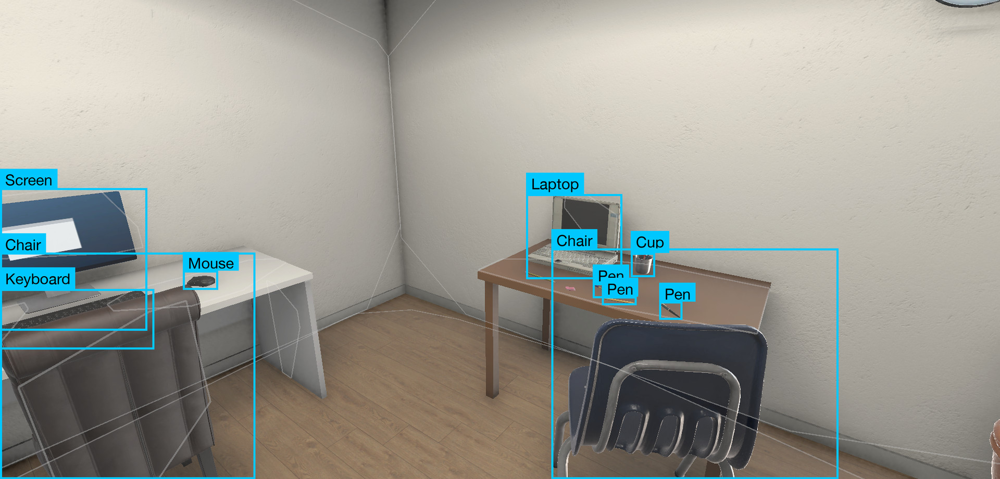
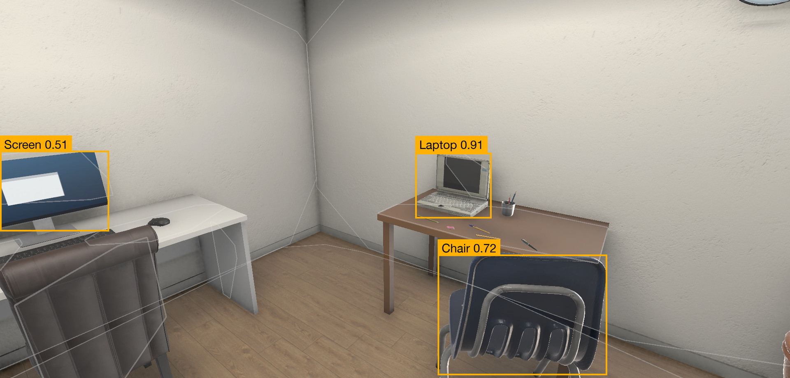
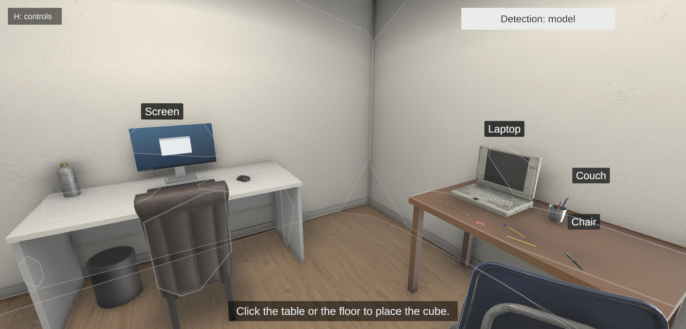
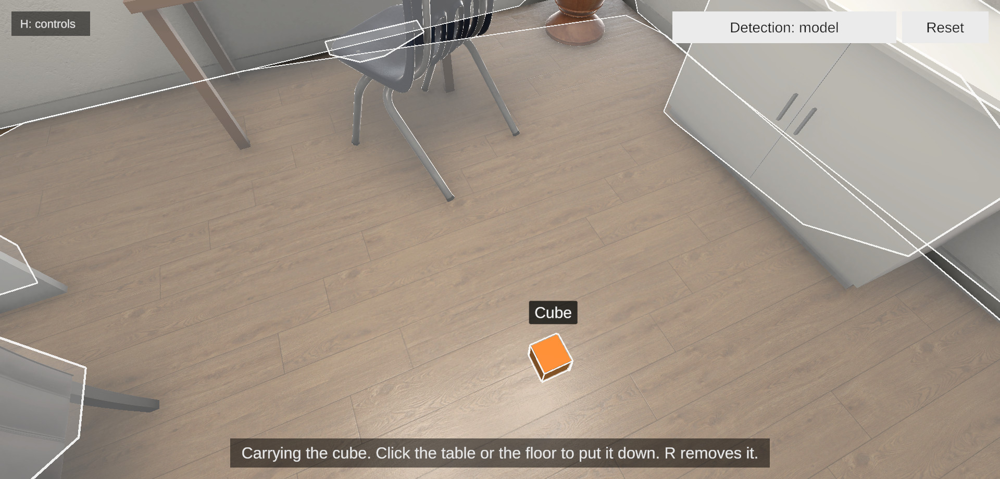

# How it works

[Back to the README](../README.md)

## The scene and the AR rig

`Assets/Scenes/Main.unity` holds the AR rig, made with AR Foundation's "XR Origin (Mobile AR)" and
"AR Session" menu items.

| Object | Components | What they do |
|---|---|---|
| XR Origin | XR Origin, AR Plane Manager, AR Raycast Manager | The centre of the tracked space. It finds surfaces and casts rays against them |
| XR Origin › Camera Offset › Main Camera | Camera, AR Camera Manager, AR Camera Background, Tracked Pose Driver | The tracked camera. The Tracked Pose Driver moves it with the device's pose, the AR Camera Manager gives the camera picture, and the background draws it |
| AR Session | AR Session, AR Input Manager | Runs the AR session |

The Main Camera is part of the rig, so it moves wherever the tracked device moves. In the Editor, XR
Simulation plays the device: it moves the camera with the keys and mouse and finds the surfaces of my test
room, `Assets/Environments/LabRoom.prefab`. XR Simulation is turned on for the desktop platform in Edit ›
Project Settings › XR Plug-in Management, and the room is already chosen.

Two of the brief's distinctions show up here:
- **Picture source.** The model's picture comes from AR Foundation's camera (AR Camera Manager), not from a
  `WebCamTexture`. A WebCamTexture gives frames only. It does not know where the camera is or how it is
  turned, so a label could not be tied to a place in the room.
- **Camera.main.** `Camera.main` is only the tracked Unity camera inside the XR Origin, used for its pose and
  lens. It is not a source of camera pictures.

## The detection sources

The Detection button goes through them in this order, and the app starts on the model:

| Setting | File | What it gives |
|---|---|---|
| model | `Scripts/Runtime/ModelSource.cs` | YOLOv9-T (COCO's 80 classes) on the camera picture inside Unity, up to 10 times a second |
| off | `Scripts/Runtime/SourceSwitch.cs` | No labels |
| fixed box (laptop only) | `Scripts/Runtime/FixedBoxSource.cs` | One 2D box I typed by hand for the laptop in the starting view: the brief's hard-coded box |
| true box | `Scripts/Runtime/TrueBoxSource.cs` | 2D boxes made from where each marked object of the room really is, projected into the picture. This stands in for a perfect detector |

All three give the rest of the app the same thing: 2D boxes in a camera picture, each with a class name, a
score, and the camera's pose and lens when the picture was taken (`Scripts/Core/CameraFrame.cs`). So the
2D-to-3D step and the labels are the same for all three.

True box mode knows 14 marked objects: the laptop, the vase, two chairs, the plant, the clock, the bottle,
the monitor (as "tv", shown as "Screen"), the keyboard, the mouse, the pencil cup (as "cup") and three pens.
The pencils and the eraser are not marked, so they have no box.

<table>
<tr>
<td width="50%"></td>
<td width="50%"></td>
</tr>
<tr>
<td align="center">True box mode at the desks: six labels, biggest objects first, so the cup, the mouse and two pens get none. The desk chair's label sits on the monitor because its box reaches up to the screen.</td>
<td align="center">True boxes at the work table. A box comes from the corners of the object's parts in 3D, so the chair's reaches up to the laptop.</td>
</tr>
<tr>
<td></td>
<td></td>
</tr>
<tr>
<td align="center">The model at the work table: Laptop, Chair and Screen.</td>
<td align="center">Model mode at the desks shows two limits: a wrong "Couch", and the school chair's label at the table instead of on the chair.</td>
</tr>
</table>

## From a 2D box to a label in the room

All in `Scripts/Runtime/DetectionPlacer.cs`, with the rules in `Scripts/Core`.

1. **Pick a point of the box.** The middle of the bottom edge, where the object meets what it stands on
   (`BoxPoint.cs`). The box centre is about half the object's height higher, so a ray through it lands behind
   the object. For a 25 cm bottle seen from 30° above that is about 22 cm, worked out by hand, not measured.
2. **Cast a ray** from the camera pose of that picture through that point. The camera may have moved since
   the picture was taken. For the model's pictures the ray goes through the camera picture's own lens (focal
   length and middle) when AR Foundation gives it, and through the screen camera's lens otherwise. The ray
   is AR Foundation's raycast against found surfaces, up to 5 m.
3. **Choose the surface.** Normally the nearest one hit. But a low ray often meets a table's front edge
   first, which the simulator finds as a small upright surface. Then the table top just behind it is used
   (`SurfaceChoice.cs`).
4. **Move back to the object's middle.** The ray met the object's front foot, so the point moves away from
   the camera by half the box's width. For a potted plant the width used is held to 0.30 m, so it moves back at
   most 0.15 m, because its leaves are much wider than its pot. There is no move back on a wall, where a clock would be pushed into the wall, or when
   the box touches the picture's bottom edge, because then the box is cut off.
5. **Size.** The width and height come from the box size at that distance. A box has no depth, so seven
   classes take a usual depth from the settings (below). Any other class takes the box width
   (`ObjectDepth.cs`). Seen from above, a box also covers the object's top, so its height is corrected.
6. **Keep.** Each label is kept at its room point (`LabelKeeper.cs`). A found object is matched to a kept
   label of the same name within 0.5 m, or to one whose room point lies inside the new box. That second rule
   is an idea from Meta's object detection sample. A label not found now is drawn at half strength after
   0.3 s. If its object is in view but not found, the label waits 1 s and fades out over 0.3 s. A label not
   found anywhere for 10 s is dropped.
7. **Choose and place.** Once a frame the labels are laid out together (`Scripts/Runtime/LabelLayout.cs`,
   `LabelArrange.cs`):
   - At most 6 are shown, biggest object in the picture first. Sizes within 25 % count as equal, and then the
     higher score wins. A label already shown counts 1.5 times its size, so similar objects do not swap.
   - An object less than 40 % in the picture gets no label.
   - Each label tries its own place above its object, then six places nearby, kept inside the picture and
     out from under the panels. The first free one wins.
   - A line joins a label to its object when they are apart. It is hidden when it would be longer than two
     label heights.
   - While the camera moves, labels keep their places. The layout is redone once the camera has been still
     for 0.5 s, and new places are reached by a 0.2 s glide.

**The label itself** (`Scripts/Runtime/WorldLabel.cs`, `Prefabs/WorldLabel.prefab`) is a small world-space
canvas with TextMesh Pro text on a dark plate:
- It lies parallel to the screen.
- It is scaled with its distance, so the text keeps one height on screen.
- It fades out from 3.5 to 4.5 m.
- Seen from above, it moves up the picture so it does not cover its object.
- It is pushed out of found walls.

It is an object in the room, not a 2D drawing over the video. It stays at its object as the view changes, and
only the layout step moves it aside a little in the picture.

## How the model runs

- **Loading.** `ModelLoader.Load` and a `Worker` on the graphics card (GPUCompute), or on the CPU where there
  are no compute shaders. The CPU path is built but not tested on this Mac.
- **The picture.** Each run takes the newest camera picture from the AR Camera Manager and stores the camera
  pose with it. The picture (the Game view's size, for example 993 x 543) is shrunk to fit the model's 640 x 640 square from the
  top-left, with the rest grey. This is done on the graphics card (`ModelPicture.cs`).
- **Running.** `ScheduleIterable` starts 40 of the model's layers a frame, so no single frame carries the whole
  run. A new run starts at most 10 times a second.
- **The result.** The output is read back from the graphics card into one kept array: 84 numbers per
  candidate box, 4 for the box and 80 class scores (`ModelOutput.cs`). Overlapping boxes of one class above
  an overlap of 0.45 are reduced to the best, and the boxes are mapped back to the camera picture.
- **Confirming.** A label shows only after its object is found in 3 runs in a row at a score of 0.40 or
  more, near the same place, and at least once not cut by the picture's edge. Once shown, it stays while the
  score is 0.30 or more (`ConfirmOverRuns.cs`).
- **Switching and pausing.** Unity keeps a finished readback's data for one frame and then disposes of it,
  which the request reports as an error. That can happen while the app is paused or out of focus, when its
  frames slow down or stop. So the result is read only when the request is done and has no error. Otherwise it
  is dropped and the next run starts (`ModelPacing.NextStep`). Coming back to the model from another source,
  the old result is dropped, and an unfinished run is finished and thrown away.

## The cube

- A press is handled in `Scripts/Runtime/CubePlacer.cs`. The decision is a plain rule
  (`Scripts/Core/PlacementRule.cs`):
  - an upward surface places the cube or puts it down
  - a wall gives a "flat surface" hint
  - nothing hit gives "no surface found there yet" for 2 s
- Click or drag is decided by how far the pointer moved while held: 2.5 % of the screen's height.
- Found surfaces are drawn faint, and in full while the cube is moved or carried.
- The cube has its own world-space label, "Cube".

 
Carrying the cube: found surfaces are drawn in full while the cube moves.

## Every setting

All tuning numbers are in `Assets/Settings/AppSettings.asset`. The settings tests read that file, so they
check the numbers the app really runs with.

| Group | Setting | Value |
|---|---|---|
| Label | Fade out from / to | 3.5 m / 4.5 m |
| Label | Most labels shown | 6 |
| Label | Sizes counted as equal | within 25 % |
| Label | Bonus for a label already shown | 0.5 (counts 1.5 times its size) |
| Label | Share of an object in the picture to get a label | 40 % |
| Label | Still before the layout is redone | 0.5 s, under 0.05 m/s and 5°/s |
| Label | Glide to a new place | 0.2 s |
| Label | In view but not found: wait, then fade | 1 s, then 0.3 s |
| Label | Not found: half strength after | 0.3 s |
| Label | Dropped when not found for | 10 s |
| Label | Longest line | 2 label heights |
| Detection | Box point | bottom middle, moved back |
| Detection | Longest ray | 5 m |
| Detection | Same object if within | 0.5 m |
| Detection | Usual depths | laptop 0.24 m, keyboard 0.14, mouse 0.11, tv 0.20, chair 0.5, clock 0.05, potted plant 0.3 (also the most width its move back uses, so at most 0.15 m back) |
| Model | Picture size | 640 x 640 |
| Model | Score to appear / to stay | 0.40 / 0.30 |
| Model | Runs in a row to appear | 3 |
| Model | Overlap limit | 0.45 |
| Model | Runs a second, at most | 10 |
| Model | Layers a frame | 40 |
| Cube and hints | Click or drag limit | 2.5 % of the screen's height |
| Cube and hints | "No surface" hint / wall hint | 2 s / 3 s |
| Cube and hints | Faint surface strength | 15 % |

The usual depths are my own figures for the props in the room, not looked up.

[Back to the README](../README.md)
