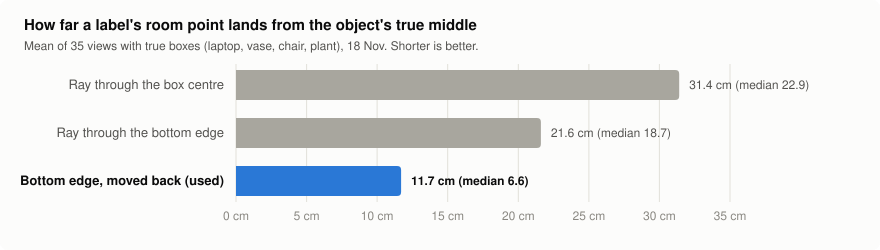

# Test results

[Back to the README](../README.md)

All numbers are from the Unity Editor 6000.3.28f1 on an Apple M1 Pro. An Editor number is not a device number.

## Edit mode tests

386 tests, all passing (21 Nov 2026). The 382 before the last fix also passed on a fresh clone opened in
batch mode. They are in `Assets/Tests/EditMode`, mostly one test file per rule file. They cover:
- the rules in `Assets/Scripts/Core`: placing, the move back, surface choice, depth, the model's output,
  confirming over runs, keeping, choosing and placing labels, the cube's press and drag rules, and hints
- a few parts in `Assets/Scripts/Runtime`: the source switch, the fixed box, the model's input picture, the
  surface outlines, the marked objects and the simulator controls

Run them with Window › General › Test Runner › Edit Mode › Run All. A ten-minute check by hand is in
[MANUAL-TEST.md](../MANUAL-TEST.md).

What tests cannot cover is anything that needs Play: the simulator, the real raycast, the model running. That
was checked with scripted Play runs, below.

## Where labels land (true boxes)

Distance from the middle of the room box to the object's true middle, in cm, with true boxes so the detector
plays no part. Views at several distances and angles.

**First measurement, 18 Nov: 35 views of the laptop, vase, chair and plant.**

<picture>
<source media="(prefers-color-scheme: dark)" srcset="images/chart-placement-dark.svg">

</picture> 
The means from the table below.

| | Box centre | Bottom edge | Bottom edge, moved back |
|---|---|---|---|
| Mean | 31.4 | 21.6 | 11.7 |
| Median | 22.9 | 18.7 | 6.6 |
| Worst | 71.0 | 39.6 | 57.1 |

The viewing angle made little difference between 10° and 30°. I had expected the bottom edge to help most at
low angles, and it did not.

**With pens and the cup added, 53 views.** The last column adds the rule that a box touching the picture's
bottom edge is not moved back.

| | Centre | Bottom edge | Moved back | Moved back, with the rule |
|---|---|---|---|---|
| Mean | 24.9 | 17.0 | 9.2 | 7.3 |
| Median | 16.9 | 15.9 | 5.0 | 5.0 |
| Worst | 71.0 | 39.6 | 57.1 | 29.8 |

**After the usual depths per class:** mean 5.9 cm, median 3.6, worst 28.9. By object: laptop 2.8, vase 2.4,
chair 11.4, plant 13.3, pen 4.6, cup 1.3.

**Last measured, after the wall rule and the plant's set-back limit (at most 0.15 m back) (18 Nov):** mean 7.1 cm, median 3.7. Two
things moved it:
- The plant went from 13.3 to 16.7. Its shorter move back is worse in front views.
- The cup went from 1.3 to 6.5. That was not the code: in that Play the simulator found the table top 6 mm
  higher. Differences of a few centimetres between two Plays can be chance.

Everything else went from 5.2 to 4.8. This table has not been measured again since 18 Nov.

## Play check of the labels, 20 Nov

One scripted set of views (stills, walks, pans and side steps in all four settings), Game view 993 x 543. It
was taken before the last label fixes (922 pictures, commit `d54d90b`), after them (`abc9fce`), and after the
repair of one of them (925 pictures, `ed193c5`), and counted by the same script.

| Measure | before | after the fixes | after the repair |
|---|---|---|---|
| Labels cut by the picture's edge | 82 | 52 | 43 |
| Found objects' labels wholly off the picture | 4 | 32 | 0 |
| Labels overlapping another label | 3 | 18 | 9 |
| Label jumps over 40 px in motion sets | 172 | 153 | 142 |
| Labels shown for objects not found at that moment | 272 | 181 | 203 |
| Same name twice, one not found | 9 | 6 | 22 |
| Labels at least a quarter under a panel | 3 | 2 | 2 |

- "Labels shown for objects not found at that moment" are kept labels drawn at half strength. They are shown
  on purpose, so a label waits at its object when the detector misses it for a moment.
- I checked the rise in "same name twice" in the pictures. They are two real objects with one name (two
  chairs, several pens), one of them faded, not old labels.
- The rise in overlaps is listed under the limits.

**Three screen sizes** (the same stills and pans in all four settings, panels not counted):

| Size | Pictures | Labels | Cut by the edge | Overlaps | Wholly off | Smallest letter height |
|---|---|---|---|---|---|---|
| 993 x 543 | 144 | 288 | 11 | 4 | 0 | 12.3 px |
| 1280 x 720 | 144 | 270 | 11 | 2 | 0 | 16.4 px |
| 800 x 1200 portrait | 143 | 172 | 16 | 4 | 0 | 27.3 px |

In portrait the panels and the hint fit, and labels stay readable. Fewer objects fit across, so more labels
are cut at the side edges in pans.

**My own picture check, 19 Nov** (107 pictures, 378 labels, one Play):
- Labels at least a quarter under a panel went from 41 to 0 after the fixes.
- The label plate height went from 18-77 px to 26-27 px.

## The two model fixes, 20 Nov

Both found in an edge-case pass and measured in Play.

| Measure | before | after |
|---|---|---|
| Errors in 11 returns to model mode with the Detection button | 2 | 0 |
| Memory made and thrown away in model mode, per second | 29.8 MB | 3.5 MB |
| The same with detection off, per second | 3.8 MB | 3.9 MB |

In a longer check (140 s, walking, 46 returns to model mode at uneven times) there were 0 errors, and 4
garbage collections in the whole run, against 34 in 180 s of model mode before.

**Losing focus (20 Nov).** During a screen recording, Unity lost focus twice and the model threw the same
error once. A graphics-card result is kept for one frame and then thrown away, and the model's earlier guard
counted frames, which slow right down while Unity is out of focus. Now a result is read only when Unity
reports it done and not thrown away. Check in Play: model mode, Unity sent behind another app and brought back
12 times (0.3 to 3 s away): 0 errors, 0 warnings, and the model still running afterwards.

**Last walk, 20 Nov evening (code at commit `1913f08`).**
- Labels showed in 92 of 96 samples while moving in model mode.
- 24 of 26 labels that were moved aside kept their line.
- Model mode made 3.5 MB of garbage a second.
- There were no errors in 11 returns to model mode.

## Speed

One YOLOv9-T run at 640 x 640 takes 26.8 ms on the graphics card and about 40 ms on the CPU. A run is spread
over frames, 40 layers a frame.

**Frame rate with the model** (18 Nov, Game view 993 x 543, Unity in front, vSync off, 900 frames each):

| Runs a second wanted | Layers a frame | Frames a second, mean | Median frame | 95th percentile | Worst | Frames over 16.7 ms | Runs a second reached |
|---|---|---|---|---|---|---|---|
| Detection off | | 354 | 2.8 ms | 3.4 ms | 6.7 ms | 0 | 0 |
| 10 | all | 227 | 3.1 ms | 9.2 ms | 27.5 ms | 39 | 9.9 |
| 10 | 20 | 287 | 3.4 ms | 4.4 ms | 8.8 ms | 0 | 8.9 |
| **10** | **40 (used)** | **269** | **3.3 ms** | **6.1 ms** | **18.8 ms** | **1** | **9.9** |
| 10 | 80 | 258 | 3.3 ms | 7.7 ms | 20.5 ms | 1 | 9.7 |
| 10 | 160 | 227 | 3.4 ms | 9.8 ms | 21.8 ms | 4 | 9.8 |

With the whole run in one frame, every run costs one frame of about 22 ms. At 40 layers a frame, one frame in
900 was long. 20 layers a frame is smoother still but reaches 8.9 runs a second, not 10.

The setting counts layers per frame, so it follows the frame rate. At 60 frames a second, 40 layers a frame
would make one run last about 14 frames, about 4 runs a second.

## Every known limit

**Device and simulation**
- Everything runs in XR Simulation in the Editor, on macOS only. It does not replace tests on a phone.
  Camera access, real camera pictures, the model's speed on a phone, tracking loss, screen notches and the
  camera picture's turn and mirroring on a phone are not tested.
- At 60 frames a second the model would run about 4 times a second, not 10.
- The model's rays use the camera picture's own lens when AR Foundation gives it, and the screen camera's
  otherwise. On a phone this is not tested.
- The cube and labels use no AR anchors. After a session reset or a tracking change on a phone they would
  likely be left in the wrong place.
- The CPU path for the model, for machines without compute shaders, is built but not tested.

**Placing labels**
- No label appears until a surface under its object has been found, so a camera that has not moved yet
  shows few or no labels.
- An object's depth is not measured. It is a usual depth for seven classes or the box width, so a room box
  can be too deep or too high. One depth per class is wrong when a long object is seen from its end.
- In true box mode the pencils and the eraser have no box, because only the three pens and the cup are
  marked.
- True boxes do not know when one object hides another. Seen across the desk chair, the keyboard, the mouse
  and the monitor get a place on the chair, 50-70 cm in front of where they are.
- In true box mode a "Chair" label can sit by the laptop, about 0.7 m from the camera, while the school chair
  is about 1.1 m away. The cause is not found.
- In true box mode, seen from straight above, the "Laptop" label can sit on the floor.
- In model mode the school chair's label sits at the work table's edge, not on the chair. My guess, not
  proven: the model's box covers only the part of the chair above the table, so the ray from its bottom edge
  meets the table top. A floor rule for chairs did not fix it in Play and was reverted.
- When no near place is free, a label can sit away from its object with its line hidden. A found object's
  label stays inside the picture.
- A kept label of an object not found now stays at its room point, so it can be cut by the picture's edge.
- "Keyboard" can overlap "Screen" at the desk, and labels crowd over the pen cup.
- Several objects of one kind close together each get their own label ("Pen" three times). They are not
  grouped into one "Pens (3)" label.
- The simulator also finds small surfaces on furniture, such as a chair's back or the laptop's screen.

**The model**
- It knows COCO's 80 classes only, so there is no pen, pencil or eraser. It labels no cup and no pen in the
  test room: it missed the cup except from 0.5 m. True box mode shows the pen case.
- It calls the laptop's and the monitor's screens "Keyboard".
- It gives short wrong names while the camera moves: "Remote", "Refrigerator" (seen once, the object not
  identified), "Couch", and "Mouse" on the pencil cup.
- It does not find the desk chair from straight behind. A box cut by the picture's edge often gets the wrong
  class ("Bicycle" for a cut-off clock), so a cut box starts no label.
- It was trained on photos and runs on a rendered room. In my first test, detectors found textured objects
  about as often as in photos, but untextured ones much less.

**Labels over time**
- A label appears after 3 runs in a row, 0.35 to 0.41 s after its object comes into view (0.09 to 0.17 s with
  one run). A wrong name can still slip through for a moment.
- A label whose object is in view but no longer found waits 1 s, then fades over 0.3 s. Out of view it stays
  up to 10 s.
- Smoothing label moves (a short hold, a glide, a bonus for labels already shown) cut jumps from 40 to 13 on my
  walks (8 of the 13 were one frame where the test moved the camera), but they are not gone: 142 jumps over
  40 px in the moving sets of the last check. Since the layout also holds while the camera moves, held labels
  can lag or be cut by the edge until the camera has been still for 0.5 s.

**The cube**
- A click on the table behind the school chair puts the cube on the chair's seat.
- A click on the table where no table surface has been found yet can put the cube on the floor under the
  table.
- A double click places the cube and picks it up at once.
- With a mouse, dragging outside the Game view can move the cube out of sight, and a click outside the Game
  view still acts.

## Privacy

The camera picture is used in memory for the detector and is never saved or sent. The app has no network code.
Unity's analytics, crash reporting, ads and performance reporting are off in the project settings.

[Back to the README](../README.md)
